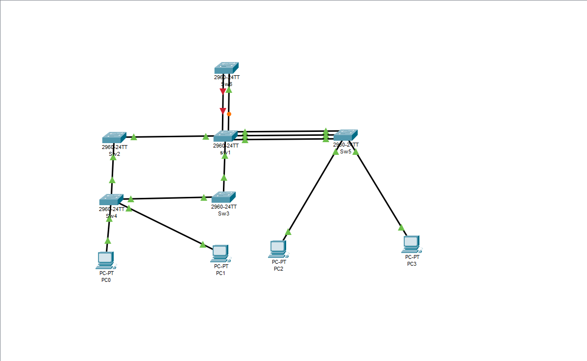

# Отчет по лабораторной работе №4
**Тема:** Spanning Tree Protocol  
**Выполнили:** Мотков М.Ю., Айдинян Г.Э., Макаров Е.А., гр. 439

## Топология



## Ответы на вопросы

1. **Анализ дерева STP по умолчанию:**
Корнем топологии (Root Bridge) выбран коммутатор **SW1**, так как при одинаковом приоритете по умолчанию (32769) побеждает коммутатор с наименьшим MAC-адресом.
Для предотвращения петель свои интерфейсы заблокировали следующие коммутаторы: **SW4 (порт Gi0/2) и SW5 (порты Fa0/2 и Fa0/3)**.
Роль заблокированных интерфейсов — **Altn** (Alternate / Альтернативный), состояние — **BLK** (Blocking / Блокировка).

```text
Sw1-VLAN0001
  Spanning tree enabled protocol ieee
  Root ID    Priority    32769
             Address     000A.419B.0790
             Cost        8
             Port        25(GigabitEthernet0/1)
             Hello Time  2 sec  Max Age 20 sec  Forward Delay 15 sec

  Bridge ID  Priority    32769  (priority 32768 sys-id-ext 1)
             Address     0090.0C99.1574
             Hello Time  2 sec  Max Age 20 sec  Forward Delay 15 sec
             Aging Time  20

Interface        Role Sts Cost      Prio.Nbr Type
---------------- ---- --- --------- -------- --------------------------------
Fa0/3            Desg LSN 19        128.3    P2p
Fa0/1            Desg LSN 19        128.1    P2p
Gi0/2            Altn BLK 4         128.26   P2p
Gi0/1            Root LSN 4         128.25   P2p
Fa0/2            Desg LSN 19        128.2    P2p


Sw2- VLAN0001
  Spanning tree enabled protocol ieee
  Root ID    Priority    32769
             Address     000A.419B.0790
             Cost        4
             Port        26(GigabitEthernet0/2)
             Hello Time  2 sec  Max Age 20 sec  Forward Delay 15 sec

  Bridge ID  Priority    32769  (priority 32768 sys-id-ext 1)
             Address     000C.CF61.B03E
             Hello Time  2 sec  Max Age 20 sec  Forward Delay 15 sec
             Aging Time  20

Interface        Role Sts Cost      Prio.Nbr Type
---------------- ---- --- --------- -------- --------------------------------
Gi0/2            Root FWD 4         128.26   P2p
Gi0/1            Desg FWD 4         128.25   P2p


Sw3 VLAN0001
  Spanning tree enabled protocol ieee
  Root ID    Priority    32769
             Address     000A.419B.0790
             Cost        4
             Port        26(GigabitEthernet0/2)
             Hello Time  2 sec  Max Age 20 sec  Forward Delay 15 sec

  Bridge ID  Priority    32769  (priority 32768 sys-id-ext 1)
             Address     00E0.F972.1642
             Hello Time  2 sec  Max Age 20 sec  Forward Delay 15 sec
             Aging Time  20

Interface        Role Sts Cost      Prio.Nbr Type
---------------- ---- --- --------- -------- --------------------------------
Gi0/1            Desg FWD 4         128.25   P2p
Gi0/2            Root FWD 4         128.26   P2p


Sw4 VLAN0001
  Spanning tree enabled protocol ieee
  Root ID    Priority    32769
             Address     000A.419B.0790
             This bridge is the root
             Hello Time  2 sec  Max Age 20 sec  Forward Delay 15 sec

  Bridge ID  Priority    32769  (priority 32768 sys-id-ext 1)
             Address     000A.419B.0790
             Hello Time  2 sec  Max Age 20 sec  Forward Delay 15 sec
             Aging Time  20

Interface        Role Sts Cost      Prio.Nbr Type
---------------- ---- --- --------- -------- --------------------------------
Fa0/11           Desg FWD 19        128.11   P2p
Fa0/10           Desg FWD 19        128.10   P2p
Gi0/2            Desg FWD 4         128.26   P2p
Gi0/1            Desg FWD 4         128.25   P2p

Sw5 VLAN0001
  Spanning tree enabled protocol ieee
  Root ID    Priority    32769
             Address     000A.419B.0790
             Cost        27
             Port        1(FastEthernet0/1)
             Hello Time  2 sec  Max Age 20 sec  Forward Delay 15 sec

  Bridge ID  Priority    32769  (priority 32768 sys-id-ext 1)
             Address     00E0.F7D3.ADC7
             Hello Time  2 sec  Max Age 20 sec  Forward Delay 15 sec
             Aging Time  20

Interface        Role Sts Cost      Prio.Nbr Type
---------------- ---- --- --------- -------- --------------------------------
Fa0/3            Altn BLK 19        128.3    P2p
Fa0/2            Altn BLK 19        128.2    P2p
Fa0/1            Root FWD 19        128.1    P2p
Fa0/11           Desg FWD 19        128.11   P2p
Fa0/10           Desg FWD 19        128.10   P2p
```

2. **Режим работы STP по умолчанию:**
Протокол STP по умолчанию работает в режиме **pvst** (Per-VLAN Spanning Tree).

```text
Switch is in pvst mode
Root bridge for:
Extended system ID           is enabled
Portfast Default             is disabled
PortFast BPDU Guard Default  is disabled
Portfast BPDU Filter Default is disabled
Loopguard Default            is disabled
EtherChannel misconfig guard is disabled
UplinkFast                   is disabled
BackboneFast                 is disabled
Configured Pathcost method used is short

Name                   Blocking Listening Learning Forwarding STP Active
---------------------- -------- --------- -------- ---------- ----------
VLAN0001                     1         0        0          4          5

---------------------- -------- --------- -------- ---------- ----------
1 vlans                      1         0        0          4          5
```

3. **Режим работы STP после настройки:**
После ввода команды `spanning-tree mode rapid-pvst` протокол работает в режиме **rapid-pvst** (Rapid PVST+).

```text
Switch is in rapid-pvst mode
Root bridge for:
Extended system ID           is enabled
Portfast Default             is disabled
PortFast BPDU Guard Default  is disabled
Portfast BPDU Filter Default is disabled
Loopguard Default            is disabled
EtherChannel misconfig guard is disabled
UplinkFast                   is disabled
BackboneFast                 is disabled
Configured Pathcost method used is short

Name                   Blocking Listening Learning Forwarding STP Active
---------------------- -------- --------- -------- ---------- ----------
VLAN0001                     2         0        0          3          5

---------------------- -------- --------- -------- ---------- ----------
1 vlans                      2         0        0          3          5
```

4. **Вывод состояния корневых коммутаторов для VLAN 1, 10 и 20:**

```text
Sw1 VLAN0001
  Spanning tree enabled protocol rstp
  Root ID    Priority    16385
             Address     0090.0C99.1574
             This bridge is the root
             Hello Time  2 sec  Max Age 20 sec  Forward Delay 15 sec

  Bridge ID  Priority    16385  (priority 16384 sys-id-ext 1)
             Address     0090.0C99.1574
             Hello Time  2 sec  Max Age 20 sec  Forward Delay 15 sec
             Aging Time  20

Interface        Role Sts Cost      Prio.Nbr Type
---------------- ---- --- --------- -------- --------------------------------
Fa0/3            Desg FWD 19        128.3    P2p
Fa0/1            Desg FWD 19        128.1    P2p
Fa0/2            Desg FWD 19        128.2    P2p
Gi0/1            Desg FWD 4         128.25   P2p
Gi0/2            Desg FWD 4         128.26   P2p

Sw2 VLAN0010
  Spanning tree enabled protocol ieee
  Root ID    Priority    16394
             Address     000C.CF61.B03E
             This bridge is the root
             Hello Time  2 sec  Max Age 20 sec  Forward Delay 15 sec

  Bridge ID  Priority    16394  (priority 16384 sys-id-ext 10)
             Address     000C.CF61.B03E
             Hello Time  2 sec  Max Age 20 sec  Forward Delay 15 sec
             Aging Time  20

Interface        Role Sts Cost      Prio.Nbr Type
---------------- ---- --- --------- -------- --------------------------------
Gi0/1            Desg FWD 4         128.25   P2p
Gi0/2            Desg FWD 4         128.26   P2p


Sw3 VLAN0020
  Spanning tree enabled protocol ieee
  Root ID    Priority    16404
             Address     00E0.F972.1642
             This bridge is the root
             Hello Time  2 sec  Max Age 20 sec  Forward Delay 15 sec

  Bridge ID  Priority    16404  (priority 16384 sys-id-ext 20)
             Address     00E0.F972.1642
             Hello Time  2 sec  Max Age 20 sec  Forward Delay 15 sec
             Aging Time  20

Interface        Role Sts Cost      Prio.Nbr Type
---------------- ---- --- --------- -------- --------------------------------
Gi0/1            Desg FWD 4         128.25   P2p
Gi0/2            Desg FWD 4         128.26   P2p
```

5. **Выбор корневого порта на SW5:**
На коммутаторе SW5 для всех VLAN корневым портом выбран **Fa0/1**.
При получении нескольких BPDU с равной стоимостью и одинаковым Bridge ID соседа коммутатор выбирает корневой порт по следующему правилу: сначала сравнивается **приоритет порта отправителя (Sender Port Priority)** — выбирается наименьший; если приоритеты равны, сравнивается **номер порта отправителя (Sender Port ID)** — выбирается порт с наименьшим номером (`Fa0/1` меньше, чем `Fa0/2` и `Fa0/3`).

6. **Корневые порты на SW5 после изменения приоритета и стоимости:**
* Для **VLAN 1** корневым портом выбран **Fa0/1**.
* Для **VLAN 10** корневым портом выбран **Fa0/2** (из-за понижения port-priority на SW1 до 112).
* Для **VLAN 20** корневым портом выбран **Fa0/3** (из-за уменьшения стоимости cost на SW5 до 10).

```text
VLAN0001
  Spanning tree enabled protocol ieee
  Root ID    Priority    16385
             Address     0090.0C99.1574
             Cost        19
             Port        1(FastEthernet0/1)
             Hello Time  2 sec  Max Age 20 sec  Forward Delay 15 sec

  Bridge ID  Priority    32769  (priority 32768 sys-id-ext 1)
             Address     00E0.F7D3.ADC7
             Hello Time  2 sec  Max Age 20 sec  Forward Delay 15 sec
             Aging Time  20

Interface        Role Sts Cost      Prio.Nbr Type
---------------- ---- --- --------- -------- --------------------------------
Fa0/3            Altn BLK 19        128.3    P2p
Fa0/2            Altn BLK 19        128.2    P2p
Fa0/1            Root FWD 19        128.1    P2p

VLAN0010
  Spanning tree enabled protocol ieee
  Root ID    Priority    16394
             Address     000C.CF61.B03E
             Cost        23
             Port        2(FastEthernet0/2)
             Hello Time  2 sec  Max Age 20 sec  Forward Delay 15 sec

  Bridge ID  Priority    32778  (priority 32768 sys-id-ext 10)
             Address     00E0.F7D3.ADC7
             Hello Time  2 sec  Max Age 20 sec  Forward Delay 15 sec
             Aging Time  20

Interface        Role Sts Cost      Prio.Nbr Type
---------------- ---- --- --------- -------- --------------------------------
Fa0/3            Altn BLK 19        128.3    P2p
Fa0/2            Root FWD 19        128.2    P2p
Fa0/1            Altn BLK 19        128.1    P2p
Fa0/10           Desg FWD 19        128.10   P2p

VLAN0020
  Spanning tree enabled protocol ieee
  Root ID    Priority    16404
             Address     00E0.F972.1642
             Cost        14
             Port        3(FastEthernet0/3)
             Hello Time  2 sec  Max Age 20 sec  Forward Delay 15 sec

  Bridge ID  Priority    32788  (priority 32768 sys-id-ext 20)
             Address     00E0.F7D3.ADC7
             Hello Time  2 sec  Max Age 20 sec  Forward Delay 15 sec
             Aging Time  20

Interface        Role Sts Cost      Prio.Nbr Type
---------------- ---- --- --------- -------- --------------------------------
Fa0/3            Root FWD 10        128.3    P2p
Fa0/2            Altn BLK 19        128.2    P2p
Fa0/1            Altn BLK 19        128.1    P2p
Fa0/11           Desg FWD 19        128.11   P2p
```

7. **Проверка Portfast на магистральных портах:**
Чтобы перевести магистральный интерфейс в режим Portfast, используется команда: `spanning-tree portfast trunk` (или `spanning-tree portfast edge trunk`).
Так **можно** делать при подключении **серверов с поддержкой VLAN (тегированного трафика)**, систем виртуализации или маршрутизаторов (router-on-a-stick).
Так **строго не рекомендуется** делать при подключении **других коммутаторов**, поскольку порт сразу перейдет в состояние пересылки (Forwarding) без прохождения этапов прослушивания и обучения, что вызовет временную петлю коммутации.

```text
Port 10 (FastEthernet0/10) of VLAN0010 is designated forwarding
  Port path cost 19, Port priority 128, Port Identifier 128.10
  Designated root has priority 16394, address 000C.CF61.B03E
  Designated bridge has priority 32778, address 000A.419B.0790
  Designated port id is 128.10, designated path cost 19
  Timers: message age 16, forward delay 0, hold 0
  Number of transitions to forwarding state: 1
  The port is in the portfast mode
  Link type is point-to-point by default
```

8. **Проверка работы BPDU Guard (интерфейс Fa0/4 на SW1):**
Интерфейс `FastEthernet0/4` находится в состоянии **down (err-disabled)**.
К этому состоянию привело получение кадра **BPDU** от подключенного коммутатора SW6 на порту с активированной защитой BPDU Guard.

```text
FastEthernet0/4 is down, line protocol is down (err-disabled)
  Hardware is Lance, address is 00d0.d3a0.1a04 (bia 00d0.d3a0.1a04)
 BW 100000 Kbit, DLY 1000 usec,
     reliability 255/255, txload 1/255, rxload 1/255
  Encapsulation ARPA, loopback not set
  Keepalive set (10 sec)
  Full-duplex, 100Mb/s
  input flow-control is off, output flow-control is off
  ARP type: ARPA, ARP Timeout 04:00:00
  Last input 00:00:08, output 00:00:05, output hang never
  Last clearing of "show interface" counters never
  Input queue: 0/75/0/0 (size/max/drops/flushes); Total output drops: 0
  Queueing strategy: fifo
  Output queue :0/40 (size/max)
  5 minute input rate 0 bits/sec, 0 packets/sec
  5 minute output rate 0 bits/sec, 0 packets/sec
     956 packets input, 193351 bytes, 0 no buffer
     Received 956 broadcasts, 0 runts, 0 giants, 0 throttles
     0 input errors, 0 CRC, 0 frame, 0 overrun, 0 ignored, 0 abort
     0 watchdog, 0 multicast, 0 pause input
     0 input packets with dribble condition detected
     2357 packets output, 263570 bytes, 0 underruns
     0 output errors, 0 collisions, 10 interface resets
     0 babbles, 0 late collision, 0 deferred
     0 lost carrier, 0 no carrier
     0 output buffer failures, 0 output buffers swapped out
```

9. **Проверка работы Root Guard (несогласованные порты на SW1):**
В списке несогласованных портов находится интерфейс **FastEthernet0/5** (состояние *Root Inconsistent*).
К этому состоянию привело получение более приоритетного (Superior) кадра **BPDU** от коммутатора SW6 (с приоритетом 4096, что меньше приоритета 16384 у SW1). Функция Root Guard заблокировала порт, чтобы не допустить смены корневого коммутатора в топологии.

```text
Name                 Interface            Inconsistency
-------------------- -------------------- ------------------
VLAN0001             FastEthernet0/5      Root Inconsistent

Number of inconsistent ports (segments) in the system : 1
```

